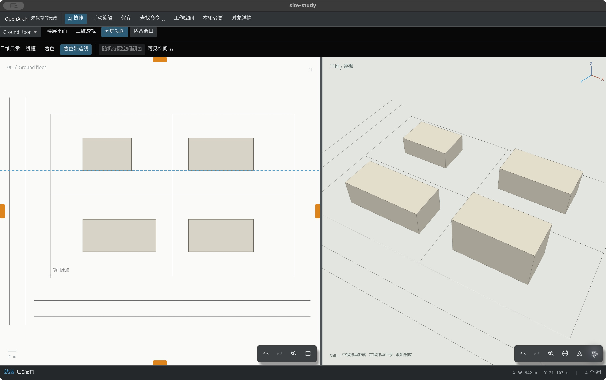

# OpenArchi

一个开源、原生桌面的建筑设计工作台，探索让建筑师与 AI 在同一份可编辑模型上共同工作。

*截图来自本仓库原创合成示例，不含真实项目资料。*

## 现在可以做什么

- **从底图开始**：将 DWG/DXF 放入工作表，确认比例和位置，在二维与三维中引用同一份底图。
- **直接推敲空间**：创建概念体量，修改轮廓、曲边和高度，在二维与三维之间调整方案。
- **保存并继续**：支持撤销、重做、保存、重新打开及异常恢复。已接入的 Agent 操作复用共享模型命令；不能自动完成建筑设计。

## 下载与启动

[OpenArchi 0.2.0 下载页](https://github.com/byewind1/openarchi/releases/tag/v0.2.0)

| 平台 | 安装包 |
| --- | --- |
| Windows x64 | [免安装 ZIP](https://github.com/byewind1/openarchi/releases/download/v0.2.0/OpenArchi-0.2.0-Windows-x64.zip) |
| macOS · M 系列 | [Apple Silicon ZIP](https://github.com/byewind1/openarchi/releases/download/v0.2.0/OpenArchi-0.2.0-macOS-arm64.zip) |
| macOS · Intel | [Intel ZIP](https://github.com/byewind1/openarchi/releases/download/v0.2.0/OpenArchi-0.2.0-macOS-intel.zip) |

Windows：解压后运行 `OpenArchi.exe`。macOS：解压后将 `OpenArchi.app` 拖到“应用程序”，需要 macOS 12 或更新版本。选择与你的处理器对应的包。

macOS 包使用本地 ad-hoc 签名，未做 Apple 公证；Windows 包未使用发行者证书签名。系统可能提示无法验证开发者，请先核对下载来源与 [SHA-256 校验文件](https://github.com/byewind1/openarchi/releases/download/v0.2.0/SHA256SUMS.txt)，再依据系统提示决定是否允许运行。组织设备可能有额外限制。

## 导入 DWG 底图

1. 打开“图纸管理器”→“放置外部图纸…”，选择 DWG/DXF 文件；确认预览后进入工作表。
2. 导入 DWG 时，在“DWG 转换器”选择你自行安装的 `dwg2dxf` 可执行程序；也可用 `OPENARCHI_DWG2DXF` 环境变量指定。ASCII DXF 可直接读取。
3. 检查预览、单位和比例，确认后放置；在“CAD 参照设置”中设置位置、标高及二维/三维可见性。
4. 保存项目；迁移文件时一并保留同名 `.assets` 文件夹。

转换器、商业 CAD 组件和额外字体均未随包提供。转换器需支持本项目调用的 `-v1 -o OUTPUT INPUT` 参数并支持 `--version`；不是任意 DWG 转换软件都能直接接入。代理实体、复杂填充、特殊文字和部分图元可能遗漏或简化，请将关键轮廓与原图核对。底图是参照，不会自动变成 BIM 构件。

## 当前边界

项目仍是早期软件，交互和格式支持持续完善，尚不能替代成熟 BIM 软件用于生产交付。重要项目请保留独立备份。

原生项目格式随所用功能独立版本化，与软件的 0.2.0 版本号不同。可读取已支持的旧格式；带新功能的文件可能无法由旧程序读取，不提供向旧格式无损降级承诺。IFC、PLN 等不宣称已实现完整互通。

本版不承诺各平台 Agent 接入能力完全相同。当前外部 MCP 适配器依赖 Unix IPC 和独立 Python 环境；Windows 桌面建模与该接入能力分别验证。

[0.2.0 更新说明](docs/更新说明-0.2.0.md) · [构建与贡献](CONTRIBUTING.md) · [许可证](LICENSE) · [第三方声明](THIRD_PARTY_NOTICES.md)

## 反馈与愿景

请在 [GitHub Issues](https://github.com/byewind1/openarchi/issues) 提交问题，附系统版本、处理器、操作步骤和脱敏示例，避免上传私人项目或凭据。

我们希望让设计意图、参考资料和模型留在同一个工作空间：AI 帮助理解与执行，人始终能够判断、修改和决定，每次探索都能在之后继续。
