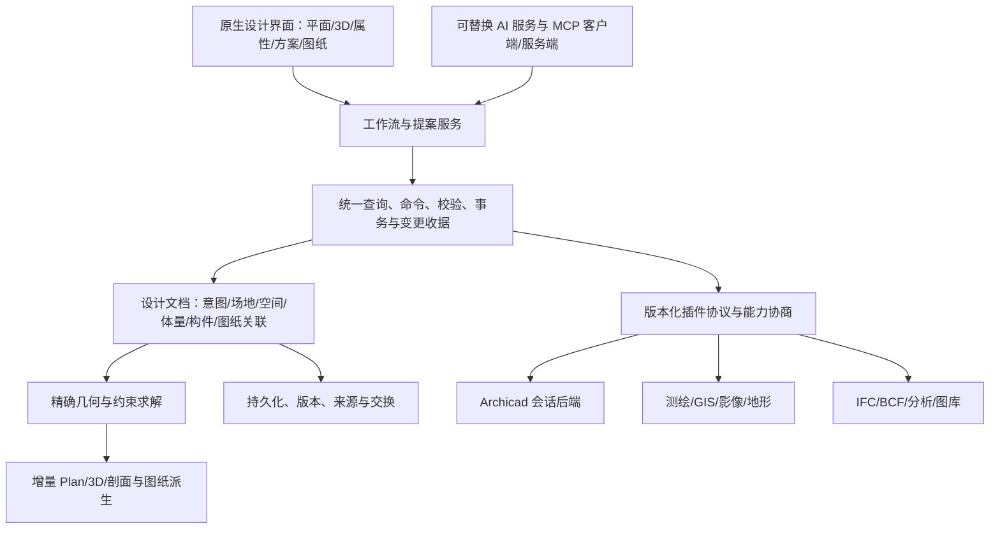

# OpenArchi：AI 原生建筑设计工作台架构评估

> 2026-10-31 后续：用户已明确原生独立完成方案至施工图的目标。当前计划将 Archicad 桥接调整为可选适配器，不作为 P0 的硬依赖；原研究和证据保留。参见 [当前架构与分阶段计划](../../../OpenArchi-架构与分阶段开发计划-2026-10-31.md)。

日期：2026-10-26。状态：**研究与架构提案，未实施、未核准实施。**

研究范围：当前 OpenArchi 工作树、已存 AC29 研究、官方 API 与行业资料、本机 Archicad 的只读命令注册探测。没有修改应用源码，没有运行建模命令，没有保存或导出用户工程。本报告的目标是选择产品架构，不是宣称功能已经实现或通过生产验收。

## 1. 核心判断

建议定位：**以设计意图和可编辑建筑模型为中心、支持多种 AI 与专业插件、逐步覆盖深化及文档生产的原生工作台。**

保留 Rust + egui/eframe + wgpu；保留独立模型。将 Archicad 作为第一个可选的专业生产后端，短期承接成熟构件、图库、PLN 和出图；长期逐步扩大 OpenArchi 原生覆盖。不要把独立开源软件的全部能力绑定到 Archicad 进程，也不要立即重做 Archicad 的全部模块。

用户的两个目标应分别管理：

- **工作流统一**：用户在 OpenArchi 内完成需求整理、方案、模型检查和任务编排，外部软件经适配器执行。可以较早实现受限闭环，但遇到尚无 API 的宿主操作仍可能需要切换窗口。
- **运行与交付独立**：无需 Archicad 许可或进程，OpenArchi 自己完成模型、图纸、交付。需要独立的几何、BIM、文档和标准交换能力，是更长期的工程目标。

不能把前者的演示当成后者已经完成。建议提供 Native Project 与 Linked Archicad Project 两种明确的文档模式，而不是让两个软件同时争夺同一份模型的写入权。

核心竞争力应是：**同一个设计从意图、场地约束、空间关系、方案比较到构件和图纸持续演化，人工修改被保留，AI 修改有依据且可撤销。** 聊天框、MCP 和自动点击都只是入口。

## 2. 当前 OpenArchi 的真实基础

证据为本轮可读源码；HEAD 为 `13101c5caf665afa7a2ae44f8ac5545bb09c7dee`，工作树已有大量未提交改动，不能单用 HEAD 代表调查版本。文件 SHA-256 见 [源码基线](2026-10-26-source-baseline.json)。

| 能力 | 当前依据 | 判断与后续工作 |
|---|---|---|
| 原生桌面与 GPU | `Cargo.toml`；`src/render.rs::SceneRenderer` | 可保留；没有必要改为 WebView |
| 独立模型 | `src/model.rs:110 Shape`、`:154 Element`、`:245 Project` | 有墙、矩形板、楼梯、多段线、宿主洞口；尚无本报告所需的通用体量、空间需求图和场地模型 |
| 共享平面/3D 数据 | `src/geometry.rs`、`src/render.rs`、`src/app/plan.rs` | 方向正确，应继续由同一模型派生，不让 AI 单独维护另一份可视模型 |
| 命令与撤销 | `src/command.rs:297 ModelCommand`；`src/editor.rs:160 commit`、`:175 apply`、`:1206 undo`、`:1218 redo` | 有类型化命令、校验和差量历史；部分路径仍先修改 Project 再计算差异，不是完整事务服务 |
| 版本计数 | `src/editor.rs:104 revision` | 已有提交/撤销/重做计数，可发展为提案并发检查；不是持久化版本库 |
| AI | `src/app/inspector.rs:710 assistant` | Summary/Quantities/Check model 为本地规则；未接真实 LLM，也没有外部工具执行服务 |
| 文件与扩展 | `src/model.rs:711 ModelAdapter`、`src/storage.rs` | 只有同步 bytes↔Project 边界和 JSON；不是插件宿主、IFC 或 PLN 实现 |
| 精度 | `src/model.rs:8 Point` 等 | f32 米制；应在接测绘数据前迁移到 f64 的领域与交换坐标 |
| 性能 | `docs/performance-baseline.md`，2026-10-18 历史测量 | 墙轮廓准备 10k 约 5.4 秒、50k 约 133 秒；非本轮复测，不能据 100k 元素校验上限承诺规模 |
| 图纸生产 | 当前模型、渲染模块及 README 范围 | 尚未形成关联平立剖、标注、详图、布局、修订和发布闭环 |

现有 `docs/architecture.md` 中部分限制说明已经落后于源码，例如“无墙接头”：当前 `geometry.rs::plan_wall_footprints` 和 `wall_outline_paths` 已有派生接头管线。应以源码与聚焦验证记录判断，不能将旧限制照抄为事实；本次不覆盖这份已有未提交修改的文档。

总体评价：**有价值的原生建模原型与可演进基础，但尚不是 AI 平台或生产级 BIM 系统。** 界面复刻已经提供操作经验，下一阶段的价值重点应转到模型语义、事务、场地和设计连续性。

## 3. Archicad 的开放程度：分层看，不以命令数量下结论

| 接入层 | 能解决什么 | 边界 |
|---|---|---|
| 官方 JSON/Python 接口 | 外部应用访问项目数据、属性及部分管理操作；可调用 Add-On 命令 | 不是全部建模 API；Python 包装层不会自动增加底层能力 |
| C++ Add-On SDK | 元素创建/修改、项目操作、图库、导航等更深的能力 | 类型、线程、事务、上下文和版本约束需要逐项验证；不是可随开源程序分发的独立 Archicad 引擎 |
| Tapir 等扩展 | 将一部分 C++ 能力封装成 JSON 命令 | 安装版本、命令注册、参数支持和实际结果是四个不同问题 |
| MCP | 向 AI 提供查询和操作工具 | 是适配协议，不提供几何内核、BIM 语义、事务保证或自动正确性 |
| UI 自动化 | 补充少量暂未开放的交互和人工验收 | 不适合作为主建模通道；难以保证幂等、批处理、状态恢复和跨版本稳定 |

AC29 固定版本文档明确包含元素创建/修改及 Add-On 机制。[AC29 Element Manager](https://raw.githubusercontent.com/GRAPHISOFT/archicad-api-devkit/29.3100/docs/group___element.html)、[AC29 Command Connection](https://raw.githubusercontent.com/GRAPHISOFT/archicad-api-devkit/29.3100/docs/group___command_connection.html)。Tapir 官方仓库说明它通过 Add-On 扩展 JSON 命令。[Tapir](https://github.com/ENZYME-APD/tapir-archicad-automation)。

### 本机只读探测

`list_instances` 返回 AC29 build 5101、端口 19723、Tapir 1.7.1。安装身份由仓库 context 记录为 Archicad 29.0.0 v1 INT (5101)，可执行文件 SHA-256：`d86af90a1fc90f0a9ef2c8565300179acc9735dda8fc3e0fe07611e8aa8b5505`。

使用 `API.IsAddOnCommandAvailable` 查询 `TapirCommand` 命名空间，以下 14 个正确名称返回 `available: true`：

- `CreateWalls`、`ModifyWalls`、`CreateSlabs`、`CreateDoors`、`CreateWindows`。
- `CreateMorphs`、`CreateZones`、`CreateMeshes`。
- `CreateAssociativeDimensions`、`CreateSections`、`CreateLayout`。
- `PublishPublisherSet`、`SaveProject`、`IFCFileOperation`。

第一次以 `Publish` 查询返回 false；核对目录后正确名称 `PublishPublisherSet` 返回 true。因此 false 不能被解释为“不能发布”。完整工具返回摘要及四个命令的连接器 schema 见 [API 探测记录](2026-10-26-api-probe.json)。这些是本次工具记录，不是 REA Evidence ID。

**已证明的是命令注册；未证明建模参数覆盖、图库依赖、批量原子性、撤销行为、图纸质量或保存重开保真。** 没有执行这些写命令，也没有用现有用户工程做试验。连接器附带 schema 可能领先于已装插件，不以其描述作为已装实现的运行证据。

已有 2026-10-20 PLN 方案中的“本机桥接握手未知”在本轮缩小为“实例可达、指定命令已注册”；端到端读改存重开仍未知。旧方案保留，不将本轮研究视为其实施授权。

### 桥接建议

先用现有官方接口/Tapir 完成有限工作流；只有白名单字段缺口被测试证明时，再开发自有 AC29 Add-On。每项能力公布 query/create/update/delete/undo/persist 的独立状态，以及 supported/partial/unsupported/unknown。保留宿主版本、插件版本和参数约束。

Archicad 应承担“受支持的专业操作与源文件保存”，OpenArchi 承担“意图、上下文、比较、任务和跨后端协议”。不得假定可脱离 Archicad 运行或将其私有库当成公共 SDK。独立 PLN 解码仍是独立研究线，不应占用早期 AI 设计主线。

## 4. 国际能力现状与产品机会

以 2026-10-26 可访问资料为边界；厂商文档、预览、论文案例与本机实测分别对待。

| 证据 | 能支持的结论 | 不能推导的结论 |
|---|---|---|
| Graphisoft AC30 AI Assistant / Supported MCP Tools | 官方正在做模型查询、批量参数操作、检查和命令执行，且有订阅及预览条件 | 本机 AC29 自动具备 AC30 工具；任意建模与图纸可无人值守完成 |
| Autodesk 2026 Forma 公告 | 场地、方案、分析、Revit/Civil 连接和 AI 工作流在汇合 | 公告/演示中的所有能力均已普遍生产可用 |
| Text-to-Layout 论文 | LLM 配合脚本可生成带构件的住宅方案案例 | 任意类型建筑、多专业及施工图的通用可靠性 |
| Text2CAD-Bench | 作者报告复杂拓扑和高级特征显著削弱模型表现 | 机械 CAD 分数可直接代表建筑设计与 BIM 质量 |
| IfcOpenShell / Bonsai | 开源 IFC 操作与模型派生图纸有可借鉴实现 | 原封嵌入 Rust 即得到完整生产级 BIM，或与本项目许可证天然兼容 |

来源：[AC30 AI Assistant](https://help.graphisoft.com/AC/30/INT/Topics/001_GettingHelp/AI_Assistant/ai_assistant_Introduction.html)、[AC30 MCP 工具](https://help.graphisoft.com/AC/30/INT/Topics/001_GettingHelp/AI_Assistant/SupportedMCPTools.html)、[Autodesk 2026-10-14 公告](https://blogs.autodesk.com/forma/2026/10/14/what-autodesk-forma-announced-au-2026/)、[Text-to-Layout](https://arxiv.org/abs/2509.00543)、[Text2CAD-Bench](https://arxiv.org/abs/2605.18430)、[IfcOpenShell](https://docs.ifcopenshell.org/)、[Bonsai 图纸文档](https://docs.bonsaibim.org/studio/guides/drawings/index.html)。论文仅核对摘要与研究范围，没有复现其结果。

不能以“Archicad 没做 AI”为战略前提。更持久的机会是：开放模型与工具选择、从概念到深化的连续可编辑性、地域化规则插件、事务级回退、准确底图与证据来源、方案比较，以及离线人工编辑。

建议将 AI 的责任限定为解释需求、提出候选、选择受控工具、解释结果与修复建议；精确几何交给确定性几何程序，约束交给求解器，工程量交给明确定义的计算，规范交给有出处和适用范围的规则及专业复核。生成图像可以支持表达，不能自动成为精确实体或施工依据。

## 5. 目标架构

以下全部为建议。先形成模块边界，稳定后再拆 Cargo workspace；不做一次性重写。

### 5.1 四类持久信息

1. **设计意图**：任务书、面积指标、邻接、采光偏好、预算目标、引用依据、确认状态。把自然语言要求编译为结构化记录，同时保留原文；不要将聊天记录直接当约束数据库。
2. **设计模型**：场地、空间、体量、楼层、构件、类型、材料、宿主和边界关系。空间可先于墙存在；前期要求不必被迫伪装成 IFC 墙。
3. **派生结果**：三角网、视图、面积表、日照/能耗结果和图纸。记录输入 revision、算法版本、容差和有效状态；源数据变更后明确标过期。
4. **变更与依据**：谁、何时、根据什么要求、修改哪些对象，使用何种工具/模型版本，结果与验证报告。记录可审计摘要，不要求保存 AI 内部推理。

这些对象可先用类型化实体表与关系索引实现，不必引入图数据库或把 IFC 当唯一内存模型。

### 5.2 概念到 BIM 的连续深化

建立 `Requirement → SpaceProgram → Space → Mass → BuildingElement → DrawingReference` 的可追踪关系，允许一对多、多对一及人工冻结。每次“深化”是新阶段模型与上游的映射，不是破坏性转换。

例：用户要求“有共享中庭、南向公共空间、约 3,000 m² 的社区建筑”。

- AI 提取面积目标、用途、邻接和偏好；不明条件标 unknown，不编造红线和规划指标。
- 场地层给出已确认边界、可建设范围、道路、标高与北向。
- 空间算法生成多个区域与体量候选，计算面积及违反约束项。
- 建筑师拖拽中庭、锁定核心筒，AI 只重算未锁定部分。
- 按明确的墙体类型、楼层、结构假设和洞口规则生成候选构件；复杂连接或未决构造留问题项。
- 深化后再改面积要求，系统先报告受影响空间、构件、分析和图纸，提供局部更新提案；不得重生成整个楼而抹掉人工设计。

这要求把“设计自由度”和“当前精度/确认程度”作为对象属性，而不是用单个 LOD 数字代替完整状态。

### 5.3 统一命令服务

现有 `ModelCommand` 是好的起点，但应增加可序列化、可版本协商的外部 DTO；不要把内部 Rust enum 或任意 Python 执行直接作为公共 API。

建议命令信封至少包含：`schema_version`、`request_id`、`document_id`、`base_revision`、目标对象及其版本、单位/坐标系、操作列表、预期影响范围、失败策略。

流程：`query → propose → validate → preview → commit → verify → receipt`。提案在快照或分支上生成，预览结束到提交之间检查 revision；过期则重算或明确冲突。无效提案不改变文档。复合操作原子提交、一次撤销；请求重试通过 request_id 去重。用户可为常见可逆操作设授权范围，不必每一步弹确认。

原生后端能保证的原子性不应自动宣称外部宿主也能保证。跨后端任务采用分阶段执行与收据：计划、宿主提交、读取核对、源文档登记；失败时冻结同步并报告状态。涉及无法事务回滚的发布/文件写入时，不用一个“撤销”掩盖残留外部结果。

### 5.4 AI 上下文与运行方式

- 上下文优先取当前选区、视图、任务、空间邻域与属性查询结果，按需分页，不将完整 BIM/全部三角网塞进 prompt。
- 精确对象 ID、单位和关系由查询服务给出；视觉模型用于定位建议和理解草图，最终选择需几何/语义确认。
- 支持多个模型供应商与本地模型；同一工具定义可用于应用内助手和外部 MCP 客户端。
- AI 任务支持流式进度、取消、预算、超时、有限重试；新请求或人工编辑可以使旧提案失效。
- 插件输出、导入文件文字与联网资料作为数据，不能直接提升权限或改变宿主执行规则。
- API key 用系统凭据存储；项目数据是否外发有明确配置；无网络仍可打开、编辑、保存和出图原生支持的内容。

### 5.5 插件架构

先做进程外插件协议（版本化 JSON-RPC over stdio 或本机 IPC），Rust 主程序不暴露可变 Project 指针，也不依赖不稳定 Rust 动态 ABI。复杂几何可使用内部 C ABI/受控进程边界；沙箱算法可后续评估 WASM，但进程外不等于自动沙箱。

插件分为：数据源、几何/分析、参数化对象、文档后端、图纸/交换、AI 工具适配。Manifest 声明协议版本、能力与 schema、读写权限、资源需求、超时、插件版本和来源。查询返回只读快照，写入返回提案，经同一命令服务提交。

插件 UI 优先使用声明式参数表单与原生面板，避免插件要求将桌面整体改成 WebView。MCP 是生态入口之一，不应成为几何缓存、文档格式和内部事务的通用传输层。

### 5.6 持久化与人工编辑保护

继续保持独立项目格式，先实现 schema 迁移、资源清单、稳定 UUID、外部 GUID 映射、快照与变更日志、损坏恢复。现有 u64 可保留为进程内索引；跨文档身份用持久 UUID。文档内分开存放用户输入、AI 提案、已提交设计和可重建缓存。

不要求立刻全量事件溯源或多人 CRDT。先做到单用户、版本化快照、可核对的变更集和方案分支。几何依赖强的并发编辑优先用版本锁与显式合并；未来团队协作再增加对象归属与冲突协议。

## 6. 精确底图与场地：应早于大规模 AI 生成

需要把“看起来对齐”与“具有工程坐标依据”分开。

| 输入 | 合适用途 | 必须记录 |
|---|---|---|
| 用户授权的测绘 DWG/DXF、坐标点、GeoTIFF、DEM | 项目坐标、边界、地形和标高依据 | 单位、CRS、垂直基准、测量日期、精度与来源；格式本身不保证正确 |
| 授权正射影像、开放 GIS 数据 | 场地理解、周边建筑、初步空间分析 | 分辨率、时间、来源及坐标变换 |
| Google 等在线地图影像 | 背景与位置参照，按服务许可使用 | 数据提供方、署名、使用条件、定位不确定性 |
| 普通截图、草图、生成图像 | 概念参考、待核对的矢量提案 | 比例/控制点、拟合误差、未确认状态，不作为测绘底图 |

建议坐标管线：源坐标/源单位 → 明确的 CRS 与高程变换 → 项目局部 f64 米制坐标 → 相机相对 f32 渲染。保留反向变换、Survey Point、Project North 与 True North。仅换 f64 还不够；必须统一容差策略、单位类型及几何算法。

PROJ 提供 CRS 转换，GDAL 提供栅格坐标与控制点机制，可通过受控适配器复用。[PROJ](https://proj.org/en/stable/about.html)、[GDAL Raster Data Model](https://gdal.org/en/stable/user/raster_data_model.html)。

无地理参照的影像：明确使用相似/仿射/其他拟合模型；仿射至少三个非共线对应点，另设独立检查点与残差报告。AI 可建议对应点，用户/测绘数据确认控制点。控制点拟合不能恢复原图本来没有的测绘精度。等高线重建需要正确高程和断裂线约束，不应从单张普通 Google 截图推断精确地形。

Google Map Tiles 官方规则涉及可视化用途、署名、存储和提取限制。因此底图插件必须按来源分别管理权限，不能默认允许下载离线瓦片或将其批量转为设计资产。开放且可归档的数据与用户测绘成果应作为可重现项目的优先输入。[Map Tiles API Policies](https://developers.google.com/maps/documentation/tile/policies)。

DXF 可作为首批明确子集；DWG 是独立适配与许可评估，不因接入 CAD 库就承诺完整往返。首批应验证单位、块变换、图层、弧线、标高和控制点，不只显示线条。

## 7. 几何、BIM 和出图的工程深度

### 几何

短期先支持可靠的 2.5D：带洞轮廓、拉伸体量、楼层分解、任意轮廓板、墙及宿主关系。复杂布尔、曲面、放样和拓扑修复经 `GeometryProvider` 评估成熟内核；OCCT 是候选，Rust 核心通过清晰边界调用，不意味主程序改用 C++。[OCCT 官方介绍](https://occt3d.com/dev/doc/overview/html/)。

采用成熟几何库也不自动得到建筑语义：连接规则、材料优先级、参考线、墙体层构造、洞口宿主、空间边界、数量算法仍需自行实现与验收。必须设计语义引用和几何命名映射，避免布尔后边号变化导致标注绑错。

性能优先级：按对象/关系 revision 做增量派生缓存；空间索引缩小墙接头候选；拾取 BVH/R-tree；异步任务与可取消；3D 实例化与局部 GPU 更新。先重测历史瓶颈，再决定实现，不能用 GPU 渲染快掩盖 CPU 几何耗时。

### BIM

必须逐步覆盖 Project/Site/Building/Storey/Space/Element、类型与实例、单位、材料层、分类属性、宿主/填充/连接关系、外部身份和责任归属。概念 Mass 与 Space 到实体构件的生成要可追踪并保留人工覆盖。

IFC 可以保留为交换边界，但身份、空间层级和关系应从现在设计。首版以目标合作软件可接受的 IFC4 交换子集为起点，按项目需要评估 IFC4.3；明确版本与交换要求，不用“最新版本”代替兼容测试。IfcOpenShell 是可评估的读写/验证组件，不是已集成依赖。[IfcOpenShell geometry API](https://docs.ifcopenshell.org/autoapi/ifcopenshell/api/geometry/index.html)。

最小导出验收包括：稳定 GlobalId、单位、楼层归属、墙板及门窗实体、宿主与洞口关系、材料/属性、坐标变换、几何和数量核对，以及独立查看器与目标软件读取。未知类型用明确只读代理并给覆盖报告；不能全部变成网格后宣称可深化 BIM。

IFC 不是 PLN 原生编辑历史/图库行为/布局的无损替代。IDS 可描述可检验的信息交付要求，BCF 可承载问题及视点；它们不自动完成消防等全部设计规范审查。标准来源：[buildingSMART IFC specifications](https://technical.buildingsmart.org/standards/ifc/ifc-schema-specifications/)、[IDS](https://www.buildingsmart.org/standards/bsi-standards/information-delivery-specification-ids/)。本轮这两页搜索摘要可访问，直接打开返回 403；实施时需取得实际 schema、规范与测试套件，不以摘要认证兼容。

### 出图

应从早期设独立 Document Engine 路线：平面切割/投影、剖面与立面、遮挡线、比例相关表达、笔与填充、关联尺寸/标签、详图引用、图框、图纸集、修订、字体与 PDF/DXF 输出。它们必须指向模型语义及 revision，不能仅保存截图。

短期 Archicad 后端可利用宿主出图能力，但“接口注册”不等于自动完成一套图；视图设置、模板、图库和发布配置必须固化为测试夹具。原生路线先完成一张总平、一层平面、一张剖面及面积表，验证模型改动引发正确更新，再扩展图纸种类。

完整施工交付是建筑类型、地域标准、构造做法、专业协同和审查流程共同约束的结果。不要用“达到某 LOD”作为全项目可施工的单一判据；MVP 应明确为方案/初步设计深度，施工图作为之后的专项产品阶段。

## 8. Archicad 后端的所有权与同步协议

**Native 模式**：OpenArchi 原生文档为模型权威；向 Archicad 输出受支持对象，登记 GUID。回读差异必须作为提案，不静默反写。

**Linked 模式**：PLN/Archicad 是生产构件与图纸的权威；OpenArchi 保存设计意图、外部对象映射、基线及显示缓存，通过后端提交白名单修改。未知原生对象保留为宿主对象，不强行降级后覆盖保存。

后端接口建议：probe、capabilities、bind-document、snapshot/query、prepare-patch、apply、readback、save-copy、verify-reopen、close。任何修改明确文档、版本/基线指纹及对象集合。检测外部编辑后拒绝过期补丁；禁止盲目覆盖两个方向。

Archicad API 操作按宿主执行约束串行排队，计算与网络等待移到 worker。连接丢失时“调用超时”不等于“没有提交”；先查询收据或对象变化，再决定是否重试。PLN 保存采取工作副本与前后基线，未经验证不覆盖唯一原件。

不试图建立跨两个应用的假全局 Undo。Linked 模式由宿主提交事务、OpenArchi 记录映射和回读结果；宿主撤销后同步状态并使相关提案失效。

## 9. 开发路线：按完整工作流推进

以下工作量等级是工程判断，不是已测工期。观察 UI/命令与重建模型/交付语义分别评估。

| 阶段 | 交付边界 | UI/工作流成本 | 模型与闭环成本 | 通过条件 |
|---|---|---|---|---|
| P0 能力与事务底座 | 可查询模型、命令提案、预览、提交、失败回退、版本检查；原生与 AC29 各一个最小事务 | 中 | 高 | 原生和临时 AC 工程各完成创建/修改/撤销/保存重开；能力及损失报告可见 |
| P1 场地到体量 | f64、可核对的底图、场地边界、空间指标、带孔体量、方案分支 | 中 | 高 | 同一测绘基线生成三个可编辑候选，能人工锁定、精确移动、保存恢复 |
| P2 体量到初步设计 | 空间、楼层、构件、宿主关系、面积表；有限 IFC 导出 | 高 | 很高 | 一个限定类型小建筑可持续深化；改意图不抹人工修改；目标软件读取 IFC |
| P3 图纸与交付 | 原生平立剖/标注/图纸集；或经过验证的 AC 输出 | 高 | 很高 | 模型改动正确更新图纸，字体/比例/数量/引用通过检查 |
| P4 扩展生态 | 插件 SDK、图库/分析/地域规则，逐步扩展建筑类型与专业 | 中至高 | 持续高 | 第三方插件可安装、卸载、失效隔离，模型仍可打开，升级不破坏工程 |

推荐首个产品切片：**一个真实但可公开/匿名化的场地，一栋约 2–4 层的小型建筑，从任务书与测绘底图生成三个方案，深化一个方案并交付方案级图纸和限定 IFC。** 这是建议测试范围，不是用户已选择的项目与面积。

如按 3–5 名全职核心成员、包含几何/BIM经验并有建筑师持续验收估算：前 8–12 周适合验证 P0 和 P1 的最小链路；6–12 个月可作为受限设计试点的规划窗口。独立生产级深化与施工图应按多年项目规划。此为低置信度资源估算，需在最初两个短周期实测吞吐后重估；AI 编码能加快实施，不能消除几何错误与建筑验收成本。

短期资源建议优先投向：命令/文档服务、精度/场地、空间/体量与可编辑深化。暂停扩散式菜单复刻，仅补首个设计工作流必需交互。Archicad 连接器先做窄闭环，不追求一开始封装几百个菜单命令。

## 10. 验收应衡量设计结果

以下是拟议验收协议，不是本轮通过结果：

- **语义**：需求被显式满足或标未知；空间、构件、材料、宿主关系及外部身份不丢失。
- **精度**：本地尺寸目标可先设 1 mm 的计算/编辑误差门槛；外部交换误差另测；地理定位按测绘合同/数据精度设门槛，绝不继承 1 mm 承诺。
- **面积**：按明确的计量规则计算；同规则跨导出前后建议先用相对差 0.1% 作为研究夹具门槛，不能当法定计容规则。
- **编辑性**：生成后人工移动/改尺寸/拆分能继续工作；再次 AI 更新保留已锁定的设计决策。
- **事务**：无效输入、重复请求、过期 revision、宿主断线、局部失败不留下未报告变更；一次设计操作对应明确撤销边界。
- **一致性**：平面、3D、剖面、面积表与图纸引用同一 revision；过期分析明确提示。
- **持久化**：保存重开与迁移前后语义相等；插件缺失能降级显示并保留原始数据。
- **互操作**：每种构件/字段的覆盖、损失、读写与往返测试独立报告；无损仅限已验子集。
- **性能**：先固定机器和项目夹具；拟以常规视图交互 P95 <100 ms、局部改动反馈 <500 ms 为起始目标，AI 网络等待单独记录；这些不是当前性能承诺。
- **AI 评测**：固定任务、输入快照、模型/工具版本，运行多次；计正确完成率、约束违反、人工修正时间、变更范围、成本与时延，不只看工具调用成功率。

最小研究夹具集应包含：长坐标测绘底图、带孔地块、坡地、两方案共享空间要求、人工锁定核心筒、带门窗宿主、图层锁定、重复请求、外部编辑冲突、断线后回读、IFC 单位/GUID、模型变更导致图纸失效。先用手工基线对照，不能只用同一个 LLM 给自己的成果打分。

## 11. 未知项与下一步验证

1. AC29 已注册命令能否按本机图库、模板与目标字段创建正确构件，并完整 undo/save/reopen：需一次性临时工程原型；本轮未做。
2. 任意体量/曲面、墙接头、多层构造、空间边界与文档关联的几何策略：需夹具对比现有算法和候选内核。
3. DWG/地图/插件分发及 OCCT、IfcOpenShell、Bonsai 等组件的具体许可证组合：实施前按锁定版本逐项评估。进程隔离不自动豁免许可证义务。
4. 目标建筑类型、地区规范、图纸深度与第一批真实样板项目尚未确定；这些影响范围及估算，但不影响先建立事务与场地精度底座。
5. AC30 和其他厂商新 AI 能力本轮仅看官方文档/公告，没有安装和对比测试；不能据此承诺跨版本行为。
6. 当前工作树完整构建、性能和最终 app 新鲜度本轮没有复验；历史 307 项 Rust / 15 项工具测试是旧记录，不能作为本轮检查结果。

## 12. 经验提炼候选（待开发者确认）

以下为可直接加入 AGENTS.md 的候选条目，本轮没有修改 AGENTS.md：

- 评估外部 CAD/BIM 能力时，分别记录连接器目录、目标命令注册、参数覆盖与端到端结果；`IsAddOnCommandAvailable=true` 只证明注册。先核对完整命名空间与命令名，避免把名称错误判断为能力缺失。
- AI、插件与 UI 的模型修改必须经过同一类型化事务服务；提案带文档和基线版本，保留人工冻结/覆盖，失败与重复请求不能静默留下额外构件。
- 测绘/GIS 接入前统一 f64 领域坐标、单位、CRS、局部原点与容差；地图影像和生成图不能自动提升为工程精度依据。
- 设计工作流同时声明模型权威、交付深度与能力子集；“在一个界面操作外部 BIM 软件”与“不依赖外部软件的独立 BIM 交付”分别验收。

## 交付与检查边界

本报告及 JSON 证据同步于 2026-10-26；Obsidian 交付目录为 `/Users/ren/Library/Mobile Documents/iCloud~md~obsidian/Documents/库/01-Projects/dev开发/OpenArchi 开发`。该目录的副本调整了本地链接。只新增研究文件并追加验证记录；未改应用源码、未建包、未提交或推送。源码与文件链接检查结果另记 `docs/validation.md`。
