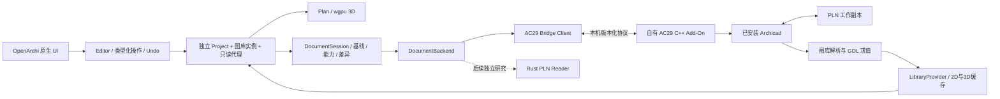

# PLN 与 Archicad 图库互操作：架构及实施方案

状态：**提案，等待用户核准；未实施。**

日期：2026-10-20。源码基线：`13101c5caf665afa7a2ae44f8ac5545bb09c7dee`，调查开始时工作树干净。用户所说的 “plan” 按 Archicad `.pln` 工程理解。本方案只针对本机 Archicad 29 INT 5101、macOS arm64；其他版本和 Windows 要分别验证。

文中的 S1–S10 对应[证据台账中的官方资料](evidence.md#官方资料)；接口存在、架构推断和运行验证分别记录。

## 1. 结论与需要核准的选择

**在已安装、能够正常运行和保存工程的 Archicad 环境中，让用户在 OpenArchi 原生界面打开 PLN、编辑受支持构件和图库实例、另存回 PLN，技术上有可行路径。** 这是一项有官方 API 基础、尚未完成本机原型验证的工程判断，不是现成能力。

需要区分两个不同目标：

| 目标 | 可行性判断 | 当前证据 |
|---|---|---|
| OpenArchi 提供原生选择、绘制、属性、撤销及渲染，Archicad 负责源工程读写和 GDL 求值 | 推荐先实现，按类型与字段逐步开放编辑 | AC29 官方 API 有工程打开/保存、元素访问/修改、图库访问接口；本机端到端未验证 |
| Rust 自行解析和生成 PLN，读取图库并独立执行全部 GDL，运行时不启动 Archicad | 可以立项研究有限子集；完整兼容的可行性、成本和工期尚不能确认 | 本次未解码 PLN 样本，未得到文件格式规范或读写调用链 |

**“安装了 Archicad”不等于可以直接调用一个独立 PLN SDK，也不等于获得可嵌入 OpenArchi 的 GDL 引擎。** 第一条路线要求 Archicad 进程参与操作，部署与版本匹配的自有 C++ Add-On；OpenArchi 主程序继续是 Rust + egui/eframe + wgpu。不把私有 framework 当成已有稳定 SDK。

建议核准范围：**P0 → P3 的条件式实施**。P0 先证明最小读、改、存、重开和图库求值链路；通过后继续 P1–P3，失败则提交实际阻碍和修订方案。独立 PLN 编解码研究 R0–R3 单独核准。当前用户授权仅覆盖调查与本方案，尚未批准任何阶段的实现。

## 2. 本项目已经具备什么

以下为可读源码与已有验证记录，详细锚点见 [evidence.md](evidence.md)。

| 层 | 当前能力 | 本任务所需补充 |
|---|---|---|
| 原生 UI、渲染 | 原生 Rust 窗口；Plan/3D 读取同一 Project；界面已拆分模块 | 异步加载/取消、代理对象、导入覆盖报告、源格式保存状态 |
| 独立 BIM 模型 | 直墙、矩形板、直跑楼梯、二维多段线、宿主墙上的矩形门窗洞口 | 外部 GUID、真实属性目录、图库实例、只读外部对象、资源引用、格式能力 |
| 编辑器 | 类型化命令、校验、可逆差量、100 步 undo/redo；部分交互使用 commit(before) | 全路径编辑权限检查，基线差异写回，源工程并发检测 |
| 持久化 | schema 1 JSON；验证后临时文件 + rename；恢复侧文件 | 文档封装、schema 迁移、源文件基线与资源清单、断线恢复 |
| 格式边界 | ModelAdapter 提供 bytes ↔ Project 接口 | 会话型 DocumentBackend；现有 trait 无法承载图库求值与增量写回 |
| 图库 | 五个内置墙/板预设 | LibraryProvider、实例参数、宏依赖、2D 符号、3D 网格与缓存 |
| 几何精度 | 本地米制 f32 | 交换层/基线保留 f64、可逆坐标变换、字段级写回，防止未编辑值被量化 |
| 性能 | 线性拾取、重绘重建几何；已有测量 | 分块导入、按 revision 缓存、代理网格缓存；先限定小型测试工程 |

现有墙接头、洞口、参考线编辑、中英文和 undo 工作是可复用基础。但墙设置中有些字段仍只是元数据；“控件存在”不代表已实现 Archicad 语义。`Shape::Opening` 也不能等同于 Archicad 的完整 GDL Door/Window。

2026-10-18 验证记录报告 258 项 Rust 测试、15 项工具测试及打包通过，并包含部分桌面实测。本轮没有重跑这些检查。早期架构笔记中“无墙接头”应理解为没有通用实体布尔模型；当前已有 Plan/3D 共用的派生接头。真实 PLN 的规模不能按 100,000 元素校验上限承诺：历史 10k 墙轮廓准备约 5.4 秒，50k 约 133 秒。

## 3. 路线取舍

| 路线 | 优点 | 主要限制 | 决策 |
|---|---|---|---|
| Archicad C++ Add-On + OpenArchi 原生编辑 | 利用实际读写器和图库运行环境；可按 GUID 修改源元素 | 依赖可运行 Archicad、匹配 SDK/Add-On、实际参数与几何提取能力 | 首选 |
| 直接 Rust PLN reader/writer | 最终可形成独立格式能力 | 容器、对象图、版本迁移、未知数据、校验和、引用重写尚未知；读与写难度不同 | 分立研究路线 |
| IFC 交换 | 可作为后续跨软件交换与核对渠道 | 项目设置、原生参数、图库行为和文档内容的保真需另验；本项目也尚无 IFC 实现 | 不作为 PLN 无损往返基础 |
| 独立调用安装目录中的私有动态库 | 看似能绕开完整应用 | 没有确认可独立初始化的公共 ABI、线程/内存/上下文契约 | 不列入交付架构 |
| 纯 UI 自动化驱动保存/导出 | 可辅助人工验证与 REA 观察 | 模态窗口、坐标、状态和大量数据读取不稳定 | 作为验收辅助 |

REA 是调查与验证工具，不是运行时 PLN 解析器。产品运行不依赖 REA/Hopper/LLM；调查得到的行为契约由独立实现与测试兑现。

## 4. 拟议架构

以上新增模块均为设计，不是当前文件。

### 4.1 职责与接口

| 拟新增模块 | 职责 |
|---|---|
| `src/interop/types.rs` | 版本化交换 DTO、f64 几何、外部身份、单位/原点/轴约定、属性/资源描述、覆盖报告 |
| `src/interop/document.rs` | DocumentSession 生命周期、基线、pending patch、冲突与保存收据 |
| `src/interop/backend.rs` | probe / capabilities / open-copy / snapshot / prepare-patch / apply / save-copy / verify / close |
| `src/interop/archicad/` | Rust 客户端、实例绑定、分页、取消、重试与错误映射；不暴露 C++ 内存布局 |
| `src/library/` | catalog / parameter-schema / evaluate-instance / dependencies / 2D、3D 和资源缓存 |
| `src/interop/mapping.rs` | 外部类型与原生类型转换、字段白名单、只读代理与损失报告 |
| `integrations/archicad29/` | 自有 C++ Add-On、SDK 构建说明、注册/加载、版本握手、受控模型操作 |
| `tests/interop/` | 原创工程夹具、字段/几何清单、往返与故障测试；不提交商业图库 |

保留当前 `ModelAdapter`/`JsonAdapter`，新增较高层文档服务；不把必须运行外部应用的过程塞进同步 `import(bytes)`。网络与文件等待放入 worker，Archicad API 调用按实际 API 的主循环/线程约束串行执行。事件回调只排队，不直接执行打开、保存等完整工程操作。

接口首选 Archicad 已有 JSON 命令入口承载自有 Add-On 命令。AC29 官方 Command Connection 文档列出 HTTP 端口查询与 JSON 调用机制 [S4]；协议细节与加载后的可达性在 P0 验证。Rust 可直接发送 JSON，不要求嵌入 Python。P0 不成功时先修订方案，不默默换成私有 ABI。

### 4.2 身份与数据模型

- `SourceDocumentId`：由导入时生成的稳定 UUID、源文件内容摘要、源版本和工作副本记录共同定位；路径只是定位提示，不是唯一身份。
- `ExternalElementKey`：文档身份 + Archicad GUID；不能用易变化的元素顺序或图库索引作为持久身份。
- `ElementBinding`：本地 ID、外部 GUID、原始 f64 字段、导入时本地投影、可编辑字段集合、源状态摘要及映射版本。
- `AttributeCatalog`：保留源图层/材质/复合结构/表面等身份。不同源目录的整数索引不能直接拼接。
- `LibraryPartRef`：图库 part 的实际持久 ID、版本/修订、包身份及依赖摘要；索引由每次 AC 会话解析。
- `CoverageReport`：逐元素标为 `NativeEditable`、`ParameterEditable`、`ReadOnlyProxy`、`Unresolved`；属性覆盖另列。缺失、降级和无法生成显示的对象仍计数并可定位。

对于 f32 原生模型，保留原始 f64 基线及导入后的投影；只有用户确实改动的白名单字段才生成 patch。未改字段不从 f32 回写。超出初期局部坐标精度预算的工程先只读；不把坐标平移后“看起来正常”当成精度证明。必要的 f64 领域模型迁移另列工程项。

不支持的对象以 `ExternalProxy` 保留 GUID、包围盒、可用的2D/3D显示和源引用；不能伪装成可编辑墙或板。Plan 与 3D 都读取同一对象绑定及 revision。缺少 2D 表达时明确提示，不静默把三维俯视投影称为原生平面符号。

### 4.3 文档与恢复

拟引入版本化 `NativeDocument` 封装 Project、绑定、属性/资源清单及导入基线，明确迁移旧 schema 1 JSON。模型语义与绑定纳入同一可恢复快照；机器专属安装路径、端口、凭据与运行 PID 留在本机会话配置。

`ProjectHeader`、`ProjectDelta`、校验、复制/删除、undo/redo、恢复和保存必须一起处理新增语义。复制一个导入元素应产生新的本地身份及 Create 意图，不能复制外部 GUID。只读代理的编辑限制必须在命令层执行，不能只靠禁用按钮。

原始 PLN 是未支持信息的保真载体。仅保存 JSON + 若干网格不构成完整可回存文档。首期保留源 PLN 不可变副本及摘要，引用本地图库；不默认把安装图库打进 OpenArchi 工程或仓库。离线可打开已保存快照、编辑允许字段，待连接后写回；缺少源副本/依赖时必须显示无法完成 PLN 保存。

## 5. 打开、编辑、撤销和回存的行为契约

本节为拟议产品行为，尚未运行验证。

1. 用户从 `File > Open` 选择 `.pln`。先处理 OpenArchi 未保存修改，再识别可用 AC29 实例与 Add-On 能力，显示原生可编辑/只读/缺失覆盖。
2. 将源文件复制到任务独有工作目录；使用可确认归属的专用 Archicad 会话。不能对用户正在工作的工程直接执行 Open。若无法安全绑定专用实例，则要求用户选择明确的测试会话，不能猜端口或项目。
3. 读取楼层、坐标、GUID、支持字段、属性、已用图库依赖及显示数据。分页期间绑定同一源 revision；发生源修改则重取快照，不能拼出混合版本。
4. 完整校验后一次替换 OpenArchi 文档。取消/错误保留原 OpenArchi 工程和历史；只清理本任务确认拥有的临时资源。
5. 在 OpenArchi 中修改受支持元素；预览不写源工程。确认一次对应一次本地撤销。Esc 恢复手势基线，且不生成 patch。
6. `Save OpenArchi` 保存本地快照；`Save a PLN Copy` 提交源格式写回。两者的 dirty/synced 状态分开。首期不提供覆盖原文件。
7. 写回由“导入/上次成功写回基线 vs 当前模型”计算，不能仅回放 ModelCommand，因为现有交互有 ChangeSet 路径。删除、新增、复制、宿主与属性依赖按支持矩阵处理；未知字段不写。
8. 执行前核对源文件摘要、文档 token、元素 GUID 与相关字段前置值。首期采用文档级冲突即拒绝，不做自动合并；外部对象被删除、工程切换、库版本改变都令相应计划失效。
9. 对基线副本准备一次写回任务。Add-On 先验证全部操作，再在支持的 undoable transaction 中修改；打开和保存处于事务外。API mask 只包含已授权且实现的字段。参数联动后的实际结果需要重新读取。
10. 保存到新的临时输出，关闭/重开该输出，比较语义清单；验证成功后才移动到目标新文件。保留完整源项目降低数据丢失风险，但 Archicad 自身重生成、迁移及关联更新仍需核对，不能预先宣称“未改对象完全不变”。
11. `operation_id` + 基线摘要 + patch 摘要关联执行收据；超时后先查询结果，禁止盲目重试创建/删除。初期不支持崩溃后透明续跑：放弃不确定工作副本，从不可变基线重建。
12. 成功保存并回读校验后，才推进外部基线；失败保留本地改动、源文件和错误报告。保存后的本地 Undo 仍可用，下次保存产生反向差异；不跨进程共享 Archicad 的撤销栈。

图库求值、缩略图和材质缓存属于派生数据，失效/重建不应改变模型 dirty 或 undo。参数变化属于模型操作，应可撤销。另存副本不自动重绑到原始文件；新输出身份在成功收据中显式记录。

## 6. 图库接入的三级能力

官方资料确认 GSM、LCF、libpack 与 XML/HSF 转换路线，并说明 AC29 的图库版本适配仍取决于代码/参数所用功能 [S6–S8]。本机已发现 `LP_XMLConverter` 和多个 libpack；本轮未转换任何图库。

| 等级 | 用户获得的能力 | 验收条件 |
|---|---|---|
| L1 目录与身份 | 查找已安装/工程使用的对象、默认参数与可用预览 | 持久 ID、包版本、语言、依赖、缺失/重名状态可辨认 |
| L2 实例显示 | OpenArchi 原生显示当前实例2D/3D，可选择与检查 | 读取实例参数而非仅默认参数；上下文与资源正确；缓存可失效 |
| L3 参数编辑/放置 | 修改经过验证的实例参数，AC 求值后返回形状，写回仍是图库实例 | 参数脚本联动、类型/数组/单位、依赖、撤销、另存重开全部通过 |

`LP_XMLConverter` 的角色是格式/元数据转换，**不是通用 GDL 求值器或 PLN 读写器**。独立执行 GDL 还涉及参数/主脚本、宏、全局变量、REQUEST、属性、楼层/比例/模型视图选项及宿主上下文。首期在 Archicad 中求值；不通过解释少数几何命令就宣称完整支持。

缓存键至少包含对象持久身份和内容/依赖摘要、实例参数、AC build、模型视图配置、比例、语言及相关宿主/属性 revision。无法确定依赖时保守失效。库文件不可达时显示缺失状态或已冻结几何，不能默默替换成同名对象。

新增对象的预览/求值可能需要临时放置；必须在工作副本或专用预览工程中进行，不能污染用户工程、默认设置或保存结果。普通家具先行；GDL 门窗要另外处理墙洞、方向、宿主和二维符号，不直接复用简化 Opening 语义。

受保护/不允许读取的脚本按不可用处理，不破解。只引用用户安装资源，不把商业图库、脚本或品牌资源随 OpenArchi 分发；未来如需分发缓存资源，应先确认对应许可范围。这是本任务资源边界，不构成对第三方授权的法律结论。

## 7. REA 如何推进真正的格式理解

不是泛查整个 Archicad，也不是从字符串猜文件结构。使用当前版本身份和可复用 Evidence，围绕以下有限问题开展：

| 问题 | 方法与输入 | 合格证据 |
|---|---|---|
| PLN 的容器边界、版本、块目录、压缩和引用是什么 | 原创空工程与单变量工程；保存两次控制时间戳/随机性；字节差异；必要时从 Open/Save 种子追踪 | 文件哈希、样本变更、偏移/长度、解码规则及未覆盖范围 |
| 一面直墙的几何、GUID、楼层/属性如何编码 | 单墙长度/厚度/位置各改一次；API 语义快照与文件差分交叉核对 | 能在未见过的样本上解析；类型/引用一致，不靠固定偏移 |
| 图库引用与嵌入数据如何关联 | 自有简单 GDL 对象、不同参数、外部/嵌入库最小样本 | 持久 ID、实例参数、依赖边与 API 读数对应 |
| 写回需重建哪些全局结构 | 先定位 reader/writer 与长度/校验/索引关系，再做受限新文件生成 | Archicad 重开、语义核对、取消/失败路径及无损范围报告 |

每次静态调查记录原程序/相关文件哈希、provider、符号地址、Evidence ID、调用边界和未解析调用。静态可达不等于运行时执行；运行观察需声明目标、动作、持续时间、文件影响和清理。API 是语义对照来源，不是 PLN 字节布局证明。

**独立路线的阶段门槛：**

- R0：最小样本库和格式目录；先辨识版本、容器、完整性，未知则停止宣布“已支持”。
- R1：Rust 只读 reader，仅解码已证实的楼层/简单墙/引用；未知块显式保留为未知。解析器设置长度/递归/解压预算并做畸形输入测试与 fuzz。
- R2：对象/属性/图库引用增量覆盖，用独立测试集交叉验证；达到声明范围后才能提供“直接读取 PLN”。
- R3：独立 writer 单独设计和核准。原样拷贝未知块不证明安全：块偏移、ID、引用、校验和与全局索引可能变化。必须证实依赖闭包后才允许改写。

完整独立 GDL 运行时另设项目；不与 R1 的 PLN 元素读取混为一件事。本次未建立任何 PLN 字节字段映射，R0–R3 均未开始实施。

## 8. 分阶段实施与验收

| 阶段 | 依赖与交付 | 通过门槛 | 失败处理 |
|---|---|---|---|
| P0 能力探针 | 用户核准；匹配 AC29 SDK、开发者/MDID、可保存的 AC29 环境；原创最小 PLN + 自有简单 GDL 对象；独立验证 Add-On | 读墙 GUID/尺寸；修改一个字段；保存新 PLN 并重开；读取对象实例参数、2D/3D，改一个参数后重生成；记录是否支持安全专用实例 | 保留证据，修订范围；不进入大规模 UI 或承诺完全兼容 |
| P1 数据与只读打开 | P0；交换协议、文档封装/迁移、身份/属性/资源、原生与代理显示、取消 | 同一工程 Plan/3D 一致；对象总数/缺失统计可解释；旧 JSON、恢复和只读限制通过 | 不开放 PLN 回存 |
| P2 简单墙完整往返 | P1；直墙指定字段白名单、基线差异、冲突、事务、保存收据、故障恢复 | 原生编辑 → Undo/Redo → 新 PLN → AC 重开；未改字段保留；取消/中断/冲突不破坏原文件 | 降为只读，不静默退化为全工程重建 |
| P3 图库实例 | P2；L1/L2 完整化，普通对象参数白名单与新放置；原生属性面板、缓存失效 | 自有对象 + 一种用户本机可用普通对象，通过参数联动、平面/3D、重开、撤销与缺库验收 | 单对象/参数禁用，保留显示和原因 |
| P4 扩大覆盖 | 另按需求安排：板轮廓/洞、门窗宿主、复杂墙、属性、其他版本、性能 | 每项新增支持都有有限验收矩阵与回归，才扩大 advertised capabilities | 保持 proxy/unknown |

P0 是独立验证探针，获准后才编写；不在本次以“调查”为名提前安装 Add-On 或修改工程。不作未经验证的整项目工期承诺；P0 结束后按实测吞吐、接口覆盖和缺口拆分估算。

### 8.1 首个有限验收工程

拟在核准后创建原创工程：一层、两面相互独立的普通直墙、一个自有简单 GDL 对象、一个暂不支持的对象/构件作为保留对照。单位为米，局部原点，固定图层/材质/MVO/比例；不用生产工程。

- 墙 A `(0,0)→(4,0)`，厚 `0.2 m`、高 `3 m`；墙 B 置于另一位置且不与 A 相交，防止接头联动掩盖字段结果。
- 在 OpenArchi 把 A 终点改为 `(5,0)`；验证长度 5 m；一次 Undo 回到 4 m，Redo 到 5 m。B 的 GUID、尺寸和属性摘要不变。
- 普通对象 P2 只读；P3 修改一个明确的宽度参数，验证参数脚本联动后的实际尺寸，保持同一 library part 身份，不能替换成 Morph/网格。
- 目标数值误差先定 `1e-5 m`（局部小坐标）；代理几何表面距离目标 `1e-4 m`。这是验收设计值，P0 需实测，不能默默放宽。曲面网格按预先固定细分精度比较，不要求三角形编号相同。
- 2D 对比固定楼层、比例、MVO、笔集和视图范围；对象的平面符号不是3D俯视图。功能几何验收与像素外观分别记录。
- 无编辑打开/另存做 no-op 对照；工程保存可能改变非语义字节，因此比较 GUID、字段、关系、属性、依赖、视图/布局清单和可见输出。只检查已声明维度，不宣称全球等价。
- 导入未知对象和未支持文档内容在源副本保留；可读取的摘要与截图比较通过，其余标 `unknown`。已编辑元素周边受影响关系应列入额外核对范围。

### 8.2 必须覆盖的负向与恢复场景

不存在/损坏/版本不支持的 PLN；库缺失、同名不同 ID、宏缺失；AC 正忙或出现模态框；连接错误实例；关闭/换工程；非法尺寸；对象只读；保存路径失败；读快照中源工程变化；保存前外部修改；Add-On/AC 崩溃；收到成功结果前客户端断线；重复 operation_id；工作副本残留；本地 JSON 保存成功但 PLN 保存失败。

安全只针对新增本机接口：限制为本机会话与允许命令、绑定文档 token、限制路径与请求体/数据块大小，记录调用结果；不新增公网服务。自有命令需要会话授权，不能因为用了 localhost 就假定不存在其他调用者。具体传输与校验在 P0 落实。

### 8.3 仓库交付检查

每个用户可试用的源码阶段按 CONTRIBUTING/AGENTS 执行格式、cargo check、相关/全量测试与工具检查，然后打包新的 `dist/OpenArchi.app`；核对 release/bundle UUID 与签名。Bridge 另外记录 SDK/Add-On 版本、加载结果与目标 AC build。

触及 UI 文本后更新 en/zh，完成最终包两个语言入口、English → 简体中文 → English、中文重启、无模型/dirty/undo变化；执行 `./scripts/cargo.sh test --all-targets` 和 `python3 scripts/ac29-workflow.py verify --force`，更新语言与验证记录。桌面验收必须实际打开本阶段最终包，不能用原型截图代替。

## 9. 待解决问题与停止条件

| 项 | 当前状态 | 谁/什么能解决 |
|---|---|---|
| 合法可保存的 AC29 会话及自有 Add-On 加载 | 本次仅确认安装身份，许可证/MDID未核验 | P0 实际加载和保存；官方注册流程 |
| 专用实例启动、端口与工程稳定绑定 | unknown | P0 运行验证；无法保证时不得自动接管用户工程 |
| 任意对象二维符号与求值上下文提取 | unknown；官方存在图库/模型访问接口不等于全覆盖 | P0 自有对象；P3 类型化测试 |
| 在 AC29 5101 上使用 SDK 29.3100 | 官方 AC29 文档可读，未编译/加载 | P0 匹配 SDK 实测，按实际可用版本固定 |
| 完整未编辑内容往返保真 | unknown | 源副本 + no-op/单字段变化对照；按清单出结果 |
| 通用 PLN 字节解码与写回 | unknown | R0–R3；无法验证则不提供独立写入 |
| 大工程吞吐与响应性 | 当前原型已有瓶颈 | P1 设小规模上限，P4 性能专项 |

## 10. 本轮完成与实施边界

已完成源码/进展审计、目标身份核对、固定 AC29 官方文档核对、有限 REA 探查和本方案。未创建/打开/修改 PLN，未转换图库，未安装 SDK/Add-On，未修改程序源代码；未构建新应用，未运行应用测试，不产生新应用 UUID/签名验收结论。未提交或推送。

REA 的主程序静态检查生成了保留记录，但完整结果超过 MCP 传输预算；导出和另一项 plist 检查被客户端 `approval policy is never` 拒绝。Hopper 查询超时，关闭也报告 `cleanup_incomplete`，保留资源为 `hopper-document`、`/tmp/rea-iBpaeU`。未强制终止用户 Hopper 或删除未确认归属的活动资源；具体记录与限制见 [evidence.md](evidence.md)。这些限制不影响文档级架构判断，但不能作为“已逆向理解 PLN”的证据。

2026-10-20 按当前 REA MCP 配置复查后，发现两份本机 PLN 候选样本；REA `open_binary` + Ghidra 对样本返回 `unsupported binary format`。AC29 Mach-O 可绑定 Ghidra 12.1.4，但本次 overview、三项定向查询与 close 都未返回。随后用 `binary_session` 核验确认本次 MCP Ghidra 会话最终为 closed、没有活动请求；CLI 搜索自身也报告 cleanup complete。样本 hash、工具状态与精确边界见 [evidence.md](evidence.md#2026-10-20-按当前-rea-mcp-链路重新调查-pln)。此轮没有生成 PLN 格式结论。

核准建议：先按本方案启动 **P0，并仅在其门槛全部通过后继续 P1–P3**。独立 PLN writer、完整 GDL 引擎、跨版本兼容和覆盖原始 PLN 不在该首期范围。
